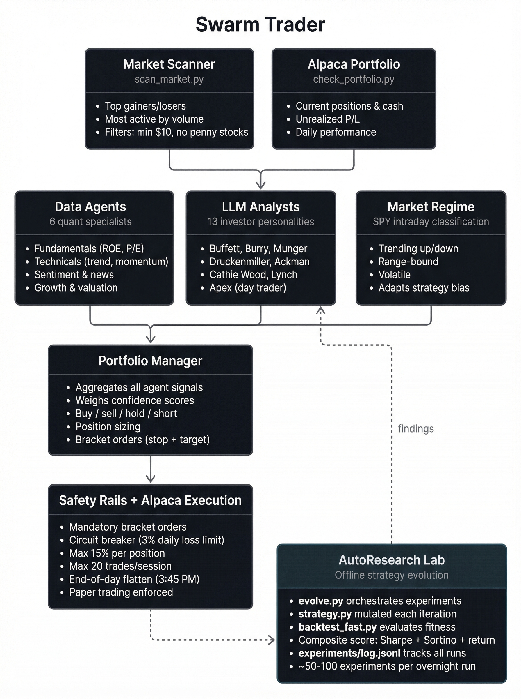
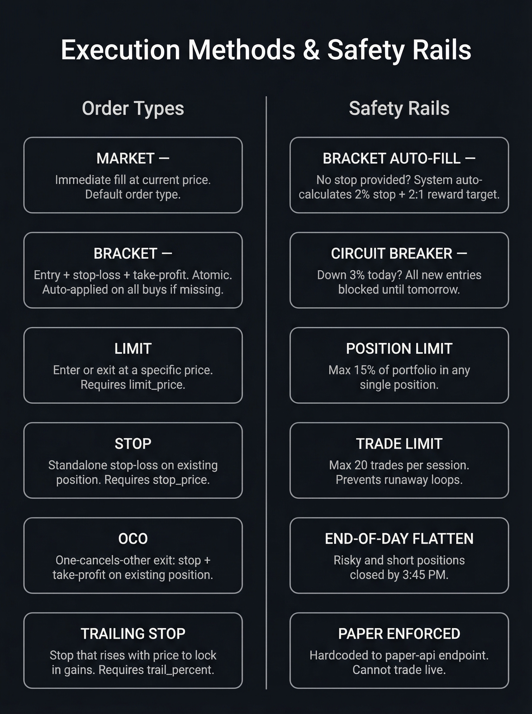

# Swarm Trader

Multi-agent AI trading system with **two autonomous modes** — swing trading and intraday day trading. 20 analyst agents (13 LLM-powered investor personalities + 7 data/quant specialists) independently analyze stocks. A Portfolio Manager aggregates their signals. Trades execute on Alpaca paper trading through a **code-enforced risk management layer** that no agent can override.

**Multi-provider LLM support** — 13 providers: OpenAI, Anthropic, Google, DeepSeek, Groq, Ollama, xAI, OpenRouter, Azure OpenAI, GigaChat, Alibaba, Meta, Mistral.

**Zero paid data APIs required.** Hybrid data layer uses SEC EDGAR + yfinance. Works fully free out of the box.

> Built on [virattt/ai-hedge-fund](https://github.com/virattt/ai-hedge-fund), extended with dual-mode trading, code-enforced risk management, free data sources, Alpaca execution, custom agents, and autonomous strategy evolution.

---

## What's Different

| Feature | Upstream | Swarm Trader |
|---|---|---|
| LLM providers | Single provider | **13 providers (Ollama, OpenAI, Anthropic, Google, etc.)** |
| Financial data | financialdatasets.ai ($200/mo) | **Hybrid: SEC EDGAR + yfinance (free)** |
| Trade execution | Simulated only | **Alpaca paper trading — market, limit, bracket, OCO, trailing stop** |
| Trading modes | Single mode | **Dual-mode: swing + day with autonomous switching** |
| Risk management | Basic | **Code-enforced risk manager — hard stops, circuit breakers, position limits** |
| Mode steering | N/A | **`trading_mode.json` — agent decides or human overrides** |
| Performance tracking | None | **Daily snapshots, SPY/QQQ comparison, Sharpe ratio** |
| Short selling | Not supported | **Full short selling support** |
| Analyst agents | 12 built-in | **20 agents (12 + apex + market regime + 6 data/quant)** |
| Custom agents | Not supported | **Create your own analyst agents** |
| Automation | Manual runs | **Scheduled OpenClaw agent pipeline** |
| Strategy evolution | None | **AutoResearch loop — AI evolves strategy.py overnight** |

---

## Dual-Mode Architecture

The system operates in two modes with separately configured Alpaca accounts. Account-aware scripts accept `--mode swing|day` and use the matching credentials; see the CLI reference for each script's flags. Swing and Day positions are not tagged by strategy inside Alpaca. Do not point both active cron families at the same account: Day's EOD flatten operates on every position in its selected account, including any Swing positions there.

### Mode Selection

The agent autonomously picks its mode each morning, or a human can override:

```
Priority order:
  1. --mode CLI flag              (cron or manual override)
  2. override in trading_mode.json (human steering with optional expiry)
  3. mode field in trading_mode.json (auto / swing / day)
  4. TRADING_MODE env var          (fallback)
  5. Default: swing               (safe baseline)
```

**`trading_mode.json`** — the steering file:

```json
{
  "mode": "auto",
  "override": null,
  "override_until": null,
  "auto_rules": {
    "prefer_day_when": ["VIX > 25", "Major earnings/FOMC day", "Morning gap >1%"],
    "prefer_swing_when": ["VIX < 20", "Strong trend in core positions", "Default"]
  }
}
```

When `mode` is `"auto"`, the agent checks VIX, pre-market gaps, and the economic calendar at market open and picks the appropriate mode. Humans can override anytime:

```python
# Human override: day mode for 4 hours
from src.config import set_mode
set_mode("day", reason="FOMC day", updated_by="human", override=True, override_hours=4)

# Or just edit trading_mode.json directly
```

### Multi-Account Routing

Swing and Day operate on their configured Alpaca accounts. Dip is a separate paper-only daemon with its own explicit credentials and instrument universe; it is not selected by the shared Swing/Day mode resolver.

| Mode | Account | Purpose |
|---|---|---|
| `swing` | Primary account | Multi-day holds, conservative risk |
| `day` | Day trading account | Intraday only, flattens EOD |
| `dip` | Dedicated Dip paper account | Opening dip mean reversion, independent process |

Credentials are configured in `.env`:

```bash
# Primary / Swing account (required)
ALPACA_API_KEY=your_swing_key
ALPACA_API_SECRET=your_swing_secret

# Day trading account (required for Day mode; must be a separate account)
ALPACA_DAY_API_KEY=your_day_key
ALPACA_DAY_API_SECRET=your_day_secret
```

Account routing is handled by `src/accounts.py`. Account-aware scripts use the credentials selected by `--mode`; if that mode's credentials are missing, they stop with an error instead of falling back to the other account. Configure separate Swing and Day Alpaca accounts before enabling both cron families. Day's end-of-day flatten closes every position in its selected account.

```python
from src.accounts import get_account_for_mode

acct = get_account_for_mode("swing")  # returns AlpacaAccount with correct keys
acct.headers  # ready-to-use API headers
```

### Opening Dip Mode

Dip Mode is a deterministic, independent long-running strategy for mean reversion near the US equity market open. It records the prior session close, watches the configured symbols using Alpaca's free IEX latest-trade feed, waits for a confirmed decline, then manages profit target and stop loss from actual fills. It may re-enter after a qualifying decline from the previous sell. It does not call an LLM. Market/session timing uses Alpaca's trading calendar and `America/New_York`.

The default is **disabled** (`DIP_CONFIG["enabled"] = False`) so installing the unit cannot submit orders by itself. When disabled, the daemon logs that setting and exits successfully; systemd will leave it inactive without a restart loop. Dip is paper-only: its adapter has the fixed `https://paper-api.alpaca.markets/v2` trading URL, reads only the `ALPACA_DIP_*` credentials, and verifies the returned paper account ID before starting. Do not point this service at another endpoint.

Configure the independent universe and strategy in `DIP_CONFIG` in [src/config.py](src/config.py). Example values (the code defaults are the source of truth):

```python
DIP_CONFIG = {
    "enabled": False,  # set True only when ready to run the paper service
    "universe": ["NVDA", "AMD", "TSLA", "SAP"],
    "pre_open_minutes": 5,
    "start": "market_open",
    "stop": "11:30",  # New York time; stops new entries, keeps managing open positions to close
    "reference": "previous_close",
    "dip_percent": 1.0,
    "confirmation_seconds": 30,
    "target_percent": 1.5,
    "stop_loss_percent": 1.0,
    "reentry_enabled": True,
    "minimum_dip_from_last_sell_percent": 0.8,
    "max_opening_gap_percent": 3.0,
    "max_trades_per_day": 5,
    "max_trades_per_instrument_per_day": 2,
    "max_position_size": 5000.0,      # maximum dollars in one position
    "max_total_exposure": 10000.0,    # maximum dollars across Dip symbols
    "max_daily_loss": None,           # optional dollar circuit breaker
    "poll_seconds": 15,
    "stale_data_seconds": 60,
    "state_file": "data/dip_state.json",
}
```

`previous_close` is the last completed daily bar before the current market session, not the premarket quote. The first regular-session trade is compared with that reference for the opening-gap guard. A gap down at or beyond `max_opening_gap_percent` blocks entries for that instrument for the day. Re-entry requires the configured decline from the last sell; the first-entry dip threshold is not reused for re-entries. Dip Mode uses Alpaca's IEX feed. If the latest trade is missing or older than `stale_data_seconds`, it falls back to the latest valid IEX bid/ask midpoint; it still blocks actions when that quote is stale or unavailable. IEX is not consolidated US market data. All prices and thresholds are percentages; `max_position_size`, `max_total_exposure`, and optional `max_daily_loss` are USD.

#### Paper account setup

Create a dedicated Alpaca paper account and put its paper API credentials and exact account ID in `.env`:

```bash
ALPACA_DIP_API_KEY=your_dip_paper_key
ALPACA_DIP_API_SECRET=your_dip_paper_secret
ALPACA_DIP_ACCOUNT_ID=your_dip_paper_account_id
```

The daemon requires all three values and fails closed if the API reports a different account. `ALPACA_DIP_ACCOUNT_ID` may match the API response's UUID `id` or its `account_number`. A mismatch stops the service cleanly; correct the identifier or use the keys belonging to the intended paper account, then restart. The account should be reserved for Dip Mode because any existing position in a configured symbol will be treated as an existing position and managed by this strategy. Keep `.env` private.

#### Service installation and operation

The service unit is [deploy/swarm-trader-dip.service](deploy/swarm-trader-dip.service). It runs as `openclaw`, loads the project `.env`, starts after networking, restarts after failures, and writes logs to journald. It does not alter or replace Swing/Day cron jobs.

```bash
sudo install -m 0644 deploy/swarm-trader-dip.service /etc/systemd/system/swarm-trader-dip.service
sudo systemctl daemon-reload
# After setting DIP_CONFIG["enabled"] = True and validating paper credentials:
sudo systemctl enable --now swarm-trader-dip.service
sudo systemctl status swarm-trader-dip.service
sudo systemctl stop swarm-trader-dip.service
sudo systemctl start swarm-trader-dip.service
sudo systemctl restart swarm-trader-dip.service
sudo journalctl -u swarm-trader-dip.service -f
```

The persisted state/status snapshot is `data/dip_state.json`; inspect it without contacting Alpaca using `poetry run python -m src.dip.daemon --status`. For a completely offline sample sequence, run `poetry run python -m src.dip.daemon --simulate`. The daemon uses an exclusive process lock, atomically saves state, and assigns deterministic per-session client order IDs before submitting an order. On restart it reconciles broker positions and open/closed order state before considering a new buy. Order fills, including partial fills and terminal rejections/cancellations, drive state transitions; order submission is never treated as an immediate fill.

Dip Mode uses market orders and polling (15 seconds by default), does not guarantee execution at the observed price, and does not flatten a remaining position at the end of its entry window. It monitors existing positions to market close for its configured target/stop. Paper trading does not model all live execution costs or slippage. The chosen thresholds need backtesting before any broader use.

### Recommended: Separate Trading Agents

For best results, run a **dedicated agent per account** rather than one agent switching modes. Each agent develops its own context, memory, and trading style:

| Agent | Role | Account | Schedule |
|---|---|---|---|
| Swing agent | Multi-day positions, sector rotation | Primary | 3 weekday jobs: 9:30 AM, 12 PM, 3 PM ET |
| Day agent | Intraday scalps, flat by close | Day trading | 5 weekday jobs: 9:30 AM, 10 AM, 12 PM, 2:30 PM, 3:45 PM ET |

This provides complete isolation — separate P&L, separate risk management, no cross-contamination between strategies. See [Automation with OpenClaw](#automation-with-openclaw) for cron setup.

### Swing Mode

Position trading over days to weeks. Diversified universe with conservative risk limits.

| Parameter | Value |
|---|---|
| Universe | Core Tech, Growth, Value/Dividend, Tactical, Hedge (29 tickers) |
| Max position | 8% of equity |
| Max sector | 30% |
| Stop loss | -7% hard stop |
| Trailing stop | 15% from peak |
| Max trades/day | 4 |
| Max positions | 12 |
| Cash reserve | Min 20% |
| Leveraged ETFs | ❌ Banned |
| Overnight holds | ✅ Yes |
| Circuit breaker | -2% daily, -5% weekly |

**Swing universe:**

| Sector | Tickers | Max Allocation |
|---|---|---|
| Core Technology | NVDA, AVGO, TSM, MSFT, AAPL, GOOGL, META, AMZN | 30% |
| Growth | PLTR, AMD, CRM, SNOW, NET, PANW | 25% |
| Value & Dividend | JPM, V, UNH, JNJ, PG, KO | 25% |
| Tactical | COIN, MSTR, RKLB, SMCI | 15% |
| Hedge | SPY, QQQ, GLD, TLT, SPCX | 15% |

### Day Trading Mode

Intraday trading with tighter stops, larger positions, and mandatory end-of-day flatten.

| Parameter | Value |
|---|---|
| Universe | Mega-Cap, Momentum, ETF Direction (19 tickers) |
| Max position | 15% of equity |
| Max sector | 50% |
| Stop loss | -1.2% tight stop |
| Trailing stop | 3% from intraday high |
| Max trades/day | 20 |
| Max positions | 8 |
| Cash reserve | Min 10% |
| Leveraged ETFs | ✅ Allowed (intraday only) |
| Overnight holds | ❌ Flattens by 3:45 PM ET |
| Circuit breaker | -3% daily, -8% weekly |

**Day universe:**

| Sector | Tickers | Max Allocation |
|---|---|---|
| Mega-Cap Liquid | NVDA, AVGO, TSM, AMD, MSFT, AAPL, META, GOOGL, AMZN | 50% |
| Momentum | PLTR, COIN, MSTR, RKLB, SMCI | 35% |
| ETF Direction | SPY, QQQ, TQQQ, SOXL, SPCX | 30% |

**Day trading features:**
- **5-min intraday bars** from Alpaca market data API
- **VWAP** — volume-weighted average price
- **RSI(14)** on 5-min timeframe
- **Volume ratio** — today's volume vs 20-day average
- **Dynamic market scanner** (`scan_market.py`) — discovers today's movers
- **Market regime detection** — trending, range-bound, or volatile
- **Mandatory EOD flatten** — `portfolio_monitor.py` auto-sells all positions after 3:45 PM ET

---

## Architecture



```
trading_mode.json        →  Agent picks swing or day mode
    ↓
Market Scanner + Portfolio State
    ↓
Data Agents (6 quant) + LLM Analysts (13 personalities) + Market Regime
    ↓
Portfolio Manager (aggregates signals, sizes positions)
    ↓
risk_manager.py          →  Code-enforced validation (rejects rule violations)
    ↓
execute_trades.py        →  Alpaca bracket orders with mandatory stops
    ↓
portfolio_monitor.py     →  Auto-sells stops, compares to SPY
    ↓
performance_tracker_v2.py →  Daily snapshots, Sharpe ratio, alpha tracking
```

---

## Risk Management (V2)

The risk manager (`risk_manager.py`) enforces **11 hard rules** that no agent can bypass. Every trade proposal passes through `validate_trade()` before execution. Violations are rejected with a clear reason.

### Rules (Code-Enforced)

| # | Rule | Swing | Day |
|---|---|---|---|
| 1 | No leveraged ETFs | ❌ Hard block | ✅ Allowed intraday |
| 2 | No moonshots (IONQ, RGTI, etc.) | ❌ Hard block | ❌ Hard block |
| 3 | Daily loss circuit breaker | -2% | -3% |
| 4 | No new buys if down for day | -3% | -2% |
| 5 | Weekly loss circuit breaker | -5% | -8% |
| 6 | Max trades per day | 4 | 20 |
| 7 | Max open positions | 12 | 8 |
| 8 | Min cash reserve | 20% | 10% |
| 9 | Max position size | 8% | 15% |
| 10 | Max sector allocation | 30% | 50% |
| 11 | Tactical/high-risk cap | 3% total | No cap |

### Mandatory Stop Losses

Every buy order automatically gets a bracket order with a stop loss:
- **Swing:** -7% hard stop from entry + 15% trailing stop from peak
- **Day:** -1.2% hard stop + 3% trailing stop from intraday high

`portfolio_monitor.py` continuously checks all positions against stops and auto-sells anything that breaches.

### Status Check

```bash
# See current risk status for either mode
poetry run python risk_manager.py --status --mode swing
poetry run python risk_manager.py --status --mode day
```

---

## Performance Tracking

`performance_tracker_v2.py` tracks daily performance against SPY and QQQ benchmarks.

```bash
# Take today's snapshot
poetry run python performance_tracker_v2.py --snapshot

# View performance report
poetry run python performance_tracker_v2.py --report

# JSON output for automation
poetry run python performance_tracker_v2.py --report --json
```

Tracks:
- Daily equity snapshots saved to `snapshots/YYYY-MM-DD.json`
- SPY and QQQ comparison (daily alpha)
- Rolling 21-day Sharpe ratio
- Win rate, average win/loss, profit factor (from trade journal)

---

## AutoResearch — Strategy Evolution Lab

> Adapted from [karpathy/autoresearch](https://github.com/karpathy/autoresearch) — Andrej Karpathy's autonomous AI research framework. We applied the same loop to trading strategy evolution.

An AI agent modifies `strategy.py` (pure Python — indicators, thresholds, signal logic), runs a fast backtest, measures fitness, keeps or reverts. ~50 experiments per overnight run.

| | Karpathy's autoresearch | Swarm Trader AutoResearch |
|---|---|---|
| What evolves | `train.py` (PyTorch training) | `strategy.py` (intraday trading rules) |
| Metric | `val_bpb` (validation loss) | Fitness = Sharpe×0.35 + Sortino×0.25 + Return%×0.20 + WinRate×0.10 + ProfitFactor×0.10 |
| Budget | 5-min GPU training run | Fast backtest on cached 5-min bars (~30s) |
| Agent | Claude Code | Claude Code (pinned to Sonnet) |

### Quick Start

```bash
# Cache historical data (one-time)
poetry run python autoresearch/backtest_fast.py --days 10

# Run baseline backtest
poetry run python autoresearch/backtest_fast.py

# Kick off evolution (25 iterations)
poetry run python autoresearch/evolve.py --iterations 25

# Review results
poetry run python autoresearch/analyze.py
```

### Files

| File | Role | Modified by |
|------|------|-------------|
| `autoresearch/strategy.py` | Pure-Python strategy (tunable params) | Agent |
| `autoresearch/backtest_fast.py` | Deterministic backtester + fitness scorer | Nobody |
| `autoresearch/evolve.py` | Evolution loop orchestrator | Nobody |
| `autoresearch/analyze.py` | Cross-run analytics | Nobody |
| `autoresearch/program.md` | Agent instructions | Human |
| `autoresearch/experiments/log.jsonl` | Full experiment history | System |

### From Research to Production

AutoResearch and live trading are **intentionally decoupled** — no auto-bridge. This is a safety feature.

1. Review `experiments/log.jsonl` — see what improved fitness
2. Decide if the finding is real alpha or overfitting
3. Manually update `src/config.py` or agent prompts
4. Monitor live performance after the change

---

## Data Sources

| Data Type | Source | Mode | Cache TTL |
|---|---|---|---|
| Prices (OHLCV) | yfinance | swing | 15 min |
| 5-min intraday bars | Alpaca market data API | day | none (live) |
| VWAP / RSI / volume | Calculated from bars | day | none |
| Financial metrics | yfinance + SEC EDGAR XBRL | swing | 24 hrs |
| Insider trades | SEC EDGAR Form 4 | swing | 7 days |
| Company news | yfinance news feed | both | 15 min |

---

## Quick Start

### Prerequisites

- Python 3.11+
- [Poetry](https://python-poetry.org/)
- [Alpaca](https://app.alpaca.markets) paper trading account (free)
- At least one LLM provider configured

### Setup

```bash
git clone https://github.com/zhound420/swarm-trader.git
cd swarm-trader
poetry install

cp .env.example .env
```

Edit `.env`:

```bash
# Required — Alpaca paper trading (primary / swing account)
ALPACA_API_KEY=your_key_here
ALPACA_API_SECRET=your_secret_here

# Optional — Separate day trading account
# If set, day mode trades on this account. If not, both modes share the primary.
ALPACA_DAY_API_KEY=your_day_key_here
ALPACA_DAY_API_SECRET=your_day_secret_here

# LLM provider (at least one)
OPENAI_API_KEY=
ANTHROPIC_API_KEY=
GOOGLE_API_KEY=
GROQ_API_KEY=
DEEPSEEK_API_KEY=

# Optional — trading mode (default: swing)
TRADING_MODE=auto
```

### Verify

```bash
# Test data layer
python test_data.py --ticker NVDA

# Check risk manager
poetry run python risk_manager.py --status --mode swing
```

### Run (Swing Mode)

```bash
# Analyze holdings
poetry run python run_hedge_fund.py --mode swing

# Execute trades (risk manager validates each one)
poetry run python run_hedge_fund.py --mode swing --execute

# Check portfolio
poetry run python check_portfolio.py --mode swing

# Preview stop monitoring without placing sells
poetry run python portfolio_monitor.py --mode swing --dry-run

# Rebalance — sell anything outside the swing universe
poetry run python rebalance.py --mode swing
```

### Run (Day Trading Mode)

```bash
# Scan for opportunities
TICKERS=$(poetry run python scan_market.py --max 25)

# Gather intraday data
poetry run python gather_data.py --mode day --tickers $TICKERS --output /tmp/data.json

# Execute trades
echo '{"trades":[{"ticker":"NVDA","action":"buy","qty":10}]}' | \
  poetry run python execute_trades.py --mode day

# Flatten all positions (end of day)
poetry run python execute_trades.py --mode day --flatten

# Market pulse check
poetry run python check_moves.py --mode day
```

---

## Order Types



| Type | When to use | Key fields |
|---|---|---|
| `market` | Default — fill immediately | — |
| `limit` | Enter/exit at a specific price | `limit_price` |
| `bracket` | Entry with automatic stop + target | `stop_price`, `take_profit` |
| `stop` | Standalone stop-loss on existing position | `stop_price` |
| `oco` | Exit-only: stop + take-profit on existing | `stop_price`, `take_profit` |
| `trailing_stop` | Stop that rises with price | `trail_percent` |

In swing mode, every buy automatically gets a bracket order with -7% stop. In day mode, stops are managed by the portfolio monitor.

---

## Analyst Agents

### LLM Agents (13)

| Agent | Philosophy |
|---|---|
| `warren_buffett` | Value investing, moats, margin of safety |
| `charlie_munger` | Quality at fair prices |
| `michael_burry` | Contrarian deep value, FCF |
| `cathie_wood` | Disruptive innovation |
| `peter_lynch` | Growth at reasonable price |
| `bill_ackman` | Activist, concentrated positions |
| `stanley_druckenmiller` | Macro, asymmetric bets |
| `ben_graham` | Deep value, net-nets |
| `phil_fisher` | Qualitative growth |
| `aswath_damodaran` | DCF valuation |
| `rakesh_jhunjhunwala` | Emerging market growth |
| `mohnish_pabrai` | Dhandho framework |
| `mordecai` | **Mode-aware contrarian** — disciplined, rules-based, pulls universe from active mode |

### Data/Quant Agents (7)

| Agent | What it does |
|---|---|
| `fundamentals_analyst` | ROE, margins, P/E, P/B |
| `technical_analyst` | Trend, momentum, volatility |
| `sentiment_analyst` | Market sentiment |
| `growth_analyst` | Revenue acceleration, R&D |
| `valuation_analyst` | Fair value models |
| `news_sentiment_analyst` | News-driven sentiment signals |
| `market_regime` | Classifies conditions: trending, range-bound, volatile |

### Custom Agents

Create your own — see `src/agents/mordecai.py` as a template. Register in `src/utils/analysts.py`. Full guide in [PLAYBOOK.md](./PLAYBOOK.md).

---

## Automation with OpenClaw

The system can run autonomously via [OpenClaw](https://github.com/openclaw/openclaw) cron jobs. Swing and Day use dedicated trading agents; the optional Dip agent below is a monitor only and reports the independent Dip paper daemon's status and logs.

### Two-Agent Setup (Recommended)

OpenClaw cron expressions below use `America/New_York` (ET).

| Time (ET) | Agent | Job | Purpose |
|---|---|---|---|---|
| 9:30 AM | Day trader | `day-morning` | Market-open scan, VIX check, identify targets |
| 9:30 AM | Swing trader | `swing-morning` | Health check, run stops, take snapshot |
| 10:00 AM | Day trader | `day-brunch` | Opening follow-up, refresh candidates, confirmed setups |
| 12:00 PM | Day trader | `day-midday` | Position check, refresh candidates, afternoon trades |
| 12:00 PM | Swing trader | `swing-midday` | Analysis, propose and execute trades |
| 2:30 PM | Day trader | `day-afternoon` | Position check, refresh candidates, afternoon trades |
| 3:00 PM | Swing trader | `swing-afternoon` | EOD review, final stops, performance report |
| 3:45 PM | Day trader | `day-flatten` | **Mandatory flatten** — close all Day positions, EOD report |

### Swing Agent Crons

```bash
# Morning health check (9:30 AM Mon-Fri)
openclaw cron add --name swing-morning \
  --cron "30 9 * * 1-5" --tz "America/New_York" --exact \
  --agent swing-agent \
  --model openai/gpt-5.6-luna \
  --session isolated \
  --announce --channel telegram --to 8545556566 \
  --best-effort-deliver \
  --message 'Morning health check.
    1. Run: poetry run python portfolio_monitor.py --mode swing
    2. Run: poetry run python risk_manager.py --status --mode swing
    3. Run: poetry run python performance_tracker_v2.py --mode swing --snapshot --force
    4. Brief report: equity, stops triggered, SPY comparison.'

# Midday analysis (12:00 PM Mon-Fri)
openclaw cron add --name swing-midday \
  --cron "0 12 * * 1-5" --tz "America/New_York" --exact \
  --agent swing-agent \
  --model openai/gpt-5.6-luna \
  --session isolated \
  --announce --channel telegram --to 8545556566 \
  --best-effort-deliver \
  --message 'Midday analysis.
    1. Gather data: poetry run python gather_data.py --mode swing --include-universe
    2. Analyze the gathered Swing universe and current Swing positions
    3. Execute confirmed JSON decisions with: poetry run python execute_trades.py --mode swing
    4. Report: trades executed, rejections from risk manager.'

# Afternoon review (3:00 PM Mon-Fri)
openclaw cron add --name swing-afternoon \
  --cron "0 15 * * 1-5" --tz "America/New_York" --exact \
  --agent swing-agent \
  --model openai/gpt-5.6-luna \
  --session isolated \
  --announce --channel telegram --to 8545556566 \
  --best-effort-deliver \
  --message 'Afternoon review.
    1. Run: poetry run python portfolio_monitor.py --mode swing
    2. Run: poetry run python performance_tracker_v2.py --mode swing --snapshot --force
    3. EOD report: daily P&L, alpha vs SPY, overnight positions.'
```

### Day Trading Agent Crons

```bash
# Market-open scan (9:30 AM ET Mon-Fri)
openclaw cron add --name day-morning \
  --cron "30 9 * * 1-5" --tz "America/New_York" --exact \
  --agent day-agent \
  --model openai/gpt-5.6-luna \
  --session isolated \
  --announce --channel telegram --to 8545556566 \
  --best-effort-deliver \
  --message 'Market-open scan.
    1. Check VIX and economic calendar
    2. Run: poetry run python scan_market.py --max 25 and retain its comma-separated ticker output
    3. Pass those tickers to: poetry run python gather_data.py --mode day --tickers <comma-separated tickers>
    4. Report: VIX level, scanned targets with entry zones, caution flags.'

# Opening follow-up (10:00 AM ET Mon-Fri)
openclaw cron add --name day-brunch \
  --cron "0 10 * * 1-5" --tz "America/New_York" --exact \
  --agent day-agent \
  --model openai/gpt-5.6-luna \
  --session isolated \
  --announce --channel telegram --to 8545556566 \
  --best-effort-deliver \
  --message 'Day opening follow-up.
    1. Run: poetry run python portfolio_monitor.py --mode day to check the Day account and apply its configured stop rules.
    2. Refresh candidates with poetry run python scan_market.py --max 25 and retain its comma-separated ticker output.
    3. Pass those tickers to poetry run python gather_data.py --mode day --tickers <comma-separated ticker output>.
    4. Review only Day account positions and fresh intraday data for confirmed setups. Do not treat Swing positions as Day positions.
    5. Submit only confirmed decisions as valid JSON shaped like {"trades":[...]} to poetry run python execute_trades.py --mode day.
    6. If no setup is confirmed, submit no orders. Report Day account equity, cash, P&L, open positions, stop actions, orders, and risk rejections.'

# Midday position check (12:00 PM ET Mon-Fri)
openclaw cron add --name day-midday \
  --cron "0 12 * * 1-5" --tz "America/New_York" --exact \
  --agent day-agent \
  --model openai/gpt-5.6-luna \
  --session isolated \
  --announce --channel telegram --to 8545556566 \
  --best-effort-deliver \
  --message 'Midday check.
    1. Run: poetry run python portfolio_monitor.py --mode day
    2. Run: poetry run python scan_market.py --max 25 and retain its comma-separated ticker output
    3. Pass those tickers to: poetry run python gather_data.py --mode day --tickers <comma-separated tickers>
    4. Review Day positions and fresh intraday data; identify confirmed afternoon setups
    5. Execute only confirmed decisions as JSON via: poetry run python execute_trades.py --mode day
    6. Report Day account equity/P&L, positions, stops, orders, and risk rejections.'

# Afternoon setup review (2:30 PM ET Mon-Fri)
openclaw cron add --name day-afternoon \
  --cron "30 14 * * 1-5" --tz "America/New_York" --exact \
  --agent day-agent \
  --model openai/gpt-5.6-luna \
  --session isolated \
  --announce --channel telegram --to 8545556566 \
  --best-effort-deliver \
  --message 'Afternoon setup review.
    1. Run: poetry run python portfolio_monitor.py --mode day
    2. Run: poetry run python scan_market.py --max 25 and retain its comma-separated ticker output
    3. Pass those tickers to: poetry run python gather_data.py --mode day --tickers <comma-separated tickers>
    4. Review Day positions and fresh intraday data; identify confirmed setups before the flatten deadline
    5. Execute only confirmed decisions as JSON via: poetry run python execute_trades.py --mode day
    6. Report Day account equity/P&L, positions, stops, orders, and risk rejections.'

# Mandatory EOD flatten (3:45 PM ET Mon-Fri)
openclaw cron add --name day-flatten \
  --cron "45 15 * * 1-5" --tz "America/New_York" --exact \
  --agent day-agent \
  --model openai/gpt-5.6-luna \
  --session isolated \
  --announce --channel telegram --to 8545556566 \
  --best-effort-deliver \
  --message 'FLATTEN — 15 min to close.
    1. Run: poetry run python execute_trades.py --mode day --flatten
    2. Verify flat without placing another sell: poetry run python portfolio_monitor.py --mode day --dry-run
    3. Run: poetry run python performance_tracker_v2.py --mode day --snapshot --force
    4. EOD report: Day account daily P&L, positions, win rate, best/worst trade, alpha vs SPY.'
```

### Dip Mode Monitoring Agent and Crons

Dip Mode runs as the `swarm-trader-dip.service` systemd daemon. Add a dedicated OpenClaw agent for read-only monitoring; these jobs report the daemon status and recent journal activity and do not place or manage trades.

Create the agent (after configuring OpenClaw's OpenAI provider):

```bash
openclaw agents add dip-agent \
  --workspace /opt/swarm-trader \
  --model openai/gpt-6-luna \
  --non-interactive
```

The OpenClaw process must be able to read the Dip service journal. Check that before enabling the jobs:

```bash
sudo -u openclaw journalctl -u swarm-trader-dip.service --since "10 minutes ago" --no-pager
```

If that returns a permission error, grant the `openclaw` user read access to the system journal (for example, add it to `systemd-journal`) and restart the OpenClaw Gateway process so it receives the updated group membership. Do not grant the monitoring agent broad `sudo` access.

These three weekday checks use New York time and send summaries to the same Telegram destination as the other examples. The morning and midday jobs stay quiet when there is no material change; the closing check always sends a short end-of-day summary. Their journal windows are sized to the intervals between checks.

```bash
# Morning check (9:35 AM ET, Mon-Fri)
openclaw cron add --name dip-morning \
  --cron "35 9 * * 1-5" --tz "America/New_York" --exact \
  --agent dip-agent \
  --model openai/gpt-6-luna \
  --session isolated \
  --announce --channel telegram --to 8545556566 \
  --best-effort-deliver \
  --message 'Dip morning monitor. Read-only: do not place, cancel, or modify orders.
    1. Run: systemctl is-active swarm-trader-dip.service
    2. Run: cd /opt/swarm-trader && poetry run python -m src.dip.daemon --status
    3. Run: journalctl -u swarm-trader-dip.service --since "20 minutes ago" --no-pager
    4. Summarize service state, positions, realized/unrealized P&L, fills, and errors from the status and journal. Send a concise Telegram update only if there is a material event or unhealthy state; otherwise return NO_REPLY.'

# Midday check after the new-entry window (11:35 AM ET, Mon-Fri)
openclaw cron add --name dip-midday \
  --cron "35 11 * * 1-5" --tz "America/New_York" --exact \
  --agent dip-agent \
  --model openai/gpt-6-luna \
  --session isolated \
  --announce --channel telegram --to 8545556566 \
  --best-effort-deliver \
  --message 'Dip midday monitor. Read-only: do not place, cancel, or modify orders.
    1. Run: systemctl is-active swarm-trader-dip.service
    2. Run: cd /opt/swarm-trader && poetry run python -m src.dip.daemon --status
    3. Run: journalctl -u swarm-trader-dip.service --since "2 hours ago" --no-pager
    4. Summarize material fills, rejected orders, errors, and current positions using both status and journal output. Note that the Dip entry window has ended while position monitoring continues. Send only if there is a material event or unhealthy state; otherwise return NO_REPLY.'

# End-of-day check after the regular session (4:05 PM ET, Mon-Fri)
openclaw cron add --name dip-close \
  --cron "5 16 * * 1-5" --tz "America/New_York" --exact \
  --agent dip-agent \
  --model openai/gpt-6-luna \
  --session isolated \
  --announce --channel telegram --to 8545556566 \
  --best-effort-deliver \
  --message 'Dip end-of-day monitor. Read-only: do not place, cancel, or modify orders.
    1. Run: systemctl is-active swarm-trader-dip.service
    2. Run: cd /opt/swarm-trader && poetry run python -m src.dip.daemon --status
    3. Run: journalctl -u swarm-trader-dip.service --since "4 hours 30 minutes ago" --no-pager
    4. Send a concise Telegram daily summary based on both status and journal output: service health, trades/fills/rejections, current positions, and any errors. Say when there was no session or no trading activity.'
```

**AutoResearch crons** (optional, after market close):

```bash
# Evolution run (5:00 PM Mon-Fri)
openclaw cron add --name autoresearch-run \
  --cron "0 17 * * 1-5" \
  --agent swing-agent \
  --model openai/gpt-5.6-luna \
  --session isolated \
  --timeout 10800 \
  --message "poetry run python autoresearch/evolve.py --iterations 50"

# Results report (8:00 PM Mon-Fri)
openclaw cron add --name autoresearch-report \
  --cron "0 20 * * 1-5" \
  --agent swing-agent \
  --model openai/gpt-5.6-luna \
  --session isolated \
  --announce --channel telegram --to 8545556566 \
  --message "Read autoresearch/experiments/log.jsonl Summarize: experiments, best fitness, top findings."
```

### Managing Crons

```bash
openclaw cron list                        # See all jobs
openclaw cron run swarm-morning           # Trigger manually
openclaw cron disable swarm-midday        # Pause a job
openclaw cron enable swarm-midday         # Resume
openclaw cron rm <job-id>                 # Delete
```

---

## CLI Reference

Account-aware scripts should be run with an explicit `--mode swing|day`; each mode routes to its configured Alpaca account.

### Core Scripts

| Script | Purpose | Key Flags |
|---|---|---|
| `run_hedge_fund.py` | Multi-agent analysis + execution | `--execute`, `--tickers`, `--mode`, `--show-reasoning` |
| `gather_data.py` | Market data gathering | `--mode`, `--tickers`, `--top N`, `--output` |
| `execute_trades.py` | Trade execution with risk validation | `--mode`, `--file`, `--flatten`, `--dry-run` |
| `risk_manager.py` | Risk status check | `--status`, `--mode` |
| `portfolio_monitor.py` | Stop loss monitoring + auto-sell | `--mode`, `--dry-run` / `--no-sell` |
| `performance_tracker_v2.py` | Mode-specific daily snapshots + benchmarking | `--mode`, `--snapshot`, `--report`, `--json`, `--days N` |
| `check_portfolio.py` | Quick portfolio overview | `--mode`, `--telegram`, `--json` |
| `check_moves.py` | Universe pulse check | `--mode` |
| `rebalance.py` | Sell non-universe positions | `--mode`, `--execute` |
| `scan_market.py` | Dynamic ticker discovery | `--max N`, `--min-price`, `--json` |
| `trade_alerts.py` | Anomaly detection | `--check`, `--mode`, `--telegram` |
| `trade_journal.py` | Trade history + stats | `--show`, `--stats`, `--ticker` |
| `intel_exchange.py` | Peer signal sharing via A2A | `--mode`, `--dry-run`, `--json` |

---

## Project Structure

```
swarm-trader/
├── run_hedge_fund.py          # Main runner — analysis + execution
├── run_analysis.py            # Wrapper for run_hedge_fund.py
├── risk_manager.py            # V2 risk manager (11 hard rules, code-enforced)
├── portfolio_monitor.py       # Stop loss monitor + auto-sell + SPY comparison
├── performance_tracker_v2.py  # Daily snapshots, Sharpe ratio, benchmarking
├── execute_trades.py          # Trade executor with risk validation
├── gather_data.py             # Market data gatherer (swing + day modes)
├── scan_market.py             # Dynamic market scanner
├── check_portfolio.py         # Quick Alpaca portfolio check
├── check_moves.py             # Universe pulse check
├── rebalance.py               # Sell positions outside active universe
├── trade_alerts.py            # Anomaly detection (mode-aware thresholds)
├── trade_journal.py           # Persistent trade log
├── intel_exchange.py          # Peer signal sharing via A2A
├── trading_mode.json          # Mode steering file (auto/swing/day + overrides)
├── PLAYBOOK.md                # Complete operations guide
├── DESIGN.md                  # V2 design document (architecture + rules)
├── .env.example               # Secrets template
├── src/
│   ├── config.py              # MODES dict — single source of truth per mode
│   ├── accounts.py            # Multi-account routing (day + swing Alpaca accounts)
│   ├── tools/
│   │   ├── api.py             # Hybrid dispatcher (paid → free fallback)
│   │   ├── api_free.py        # Free data layer (SEC EDGAR + yfinance)
│   │   └── api_original.py    # Original financialdatasets.ai client
│   ├── agents/
│   │   ├── mordecai.py        # Mode-aware contrarian agent
│   │   ├── apex.py            # Intraday day trading agent
│   │   ├── market_regime.py   # Market regime classifier
│   │   ├── portfolio_manager.py
│   │   └── ...                # 12 LLM + 6 data/quant agents
│   ├── alpaca_integration.py  # Alpaca API helpers + V2 risk integration
│   └── llm/
│       └── models.py          # 13 LLM provider definitions
├── autoresearch/
│   ├── strategy.py            # Evolved strategy (agent-modified)
│   ├── evolve.py              # Evolution loop orchestrator
│   ├── backtest_fast.py       # Fast backtester + fitness scorer
│   ├── analyze.py             # Cross-run analytics
│   └── experiments/           # Experiment logs
├── snapshots/                 # Daily performance snapshots
├── data/                      # Trade journal, alerts, performance history
└── docs/
    ├── architecture.png       # System architecture diagram
    └── execution-methods.png  # Order types + safety rails reference
```

---

## Configuration

### Mode Config (`src/config.py`)

All configuration lives in the `MODES` dict — one complete, self-contained config per mode:

```python
from src.config import get_mode_config

config = get_mode_config("swing")  # or "day"
universe = config["universe"]      # sector → tickers + caps
risk = config["risk"]              # all risk parameters
```

### Mode Steering (`trading_mode.json`)

```python
from src.config import resolve_mode, set_mode

# Check current mode
mode = resolve_mode()  # "auto", "swing", or "day"

# Agent sets mode
set_mode("swing", reason="VIX 18, low vol", updated_by="agent")

# Human override for 4 hours
set_mode("day", reason="FOMC day", updated_by="human", override=True, override_hours=4)
```

---

## Troubleshooting

| Problem | Cause | Fix |
|---|---|---|
| `BLOCKED: Daily circuit breaker` | Down past limit today | Normal — resets next trading day |
| `BLOCKED: Max 12 open positions` | Too many positions | Close something first or switch to day mode (8 max) |
| `BLOCKED: leveraged ETF` | Trying to buy TQQQ in swing mode | Switch to day mode or remove the trade |
| `ALPACA_API_KEY not set` | Missing `.env` | Copy `.env.example` to `.env` |
| `No Alpaca account configured for mode 'day'` | Day credentials are missing | Add `ALPACA_DAY_API_KEY` and `ALPACA_DAY_API_SECRET` to `.env` |
| `insufficient qty` on sell | Shares locked by open orders | Cancel orders via Alpaca dashboard |
| Scanner returns only core tickers | Market closed | Scanner works during market hours |
| Risk manager rejects everything | Multiple rules violated | Run `risk_manager.py --status` to see what's wrong |
| `flatten` sells nothing | No positions or market closed | Expected behavior |

---

## Credits

Built on [virattt/ai-hedge-fund](https://github.com/virattt/ai-hedge-fund). Extended with dual-mode trading, code-enforced risk management, free data sources, Alpaca execution, and autonomous strategy evolution.

AutoResearch loop adapted from [karpathy/autoresearch](https://github.com/karpathy/autoresearch). Core idea and architecture are his — we ported it to trading strategy evolution.

## Disclaimer

Educational and research purposes only. Not investment advice. Paper trading only.

## License

MIT
