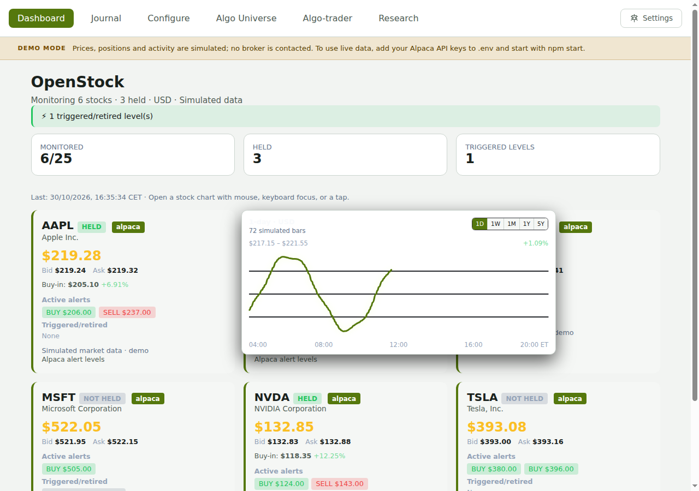
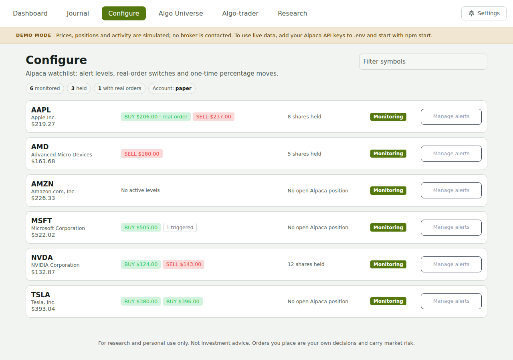
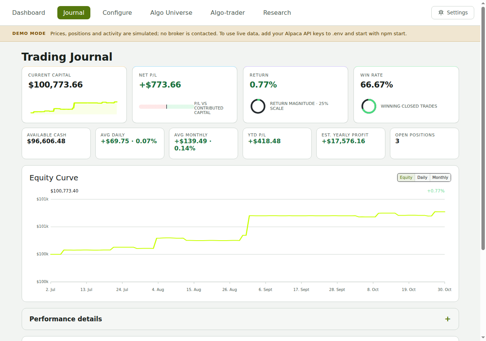
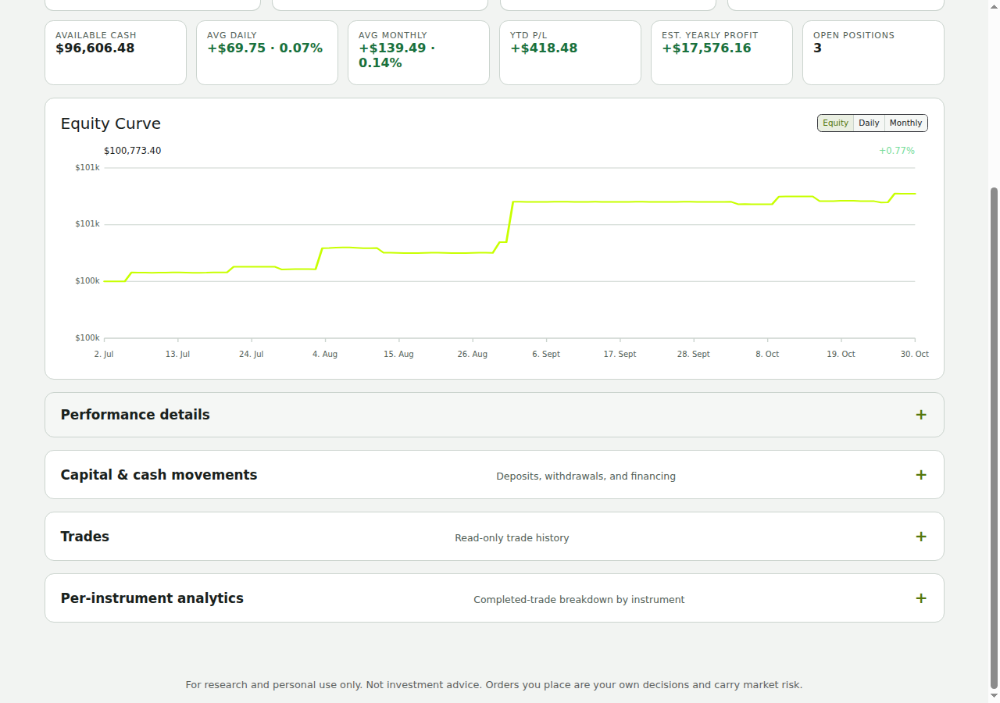
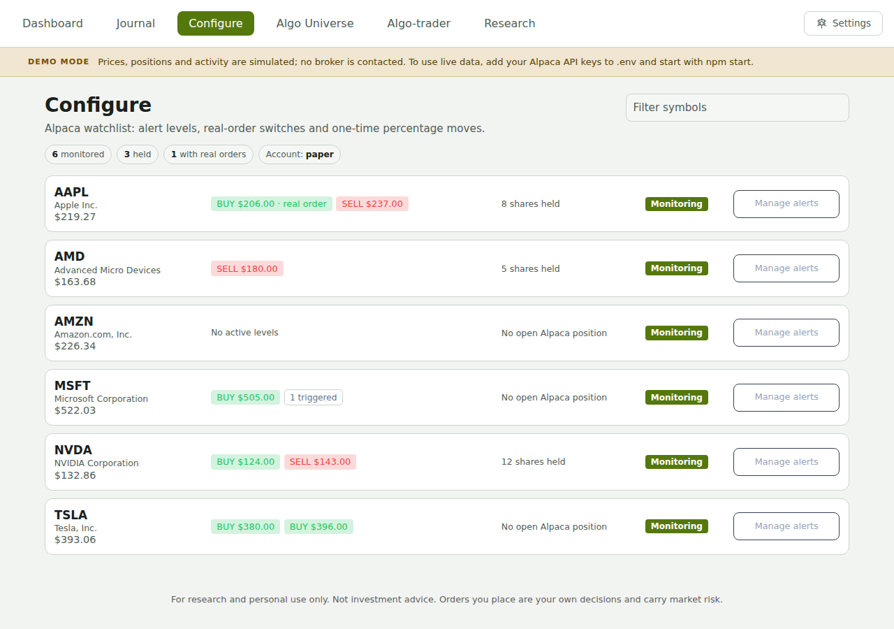
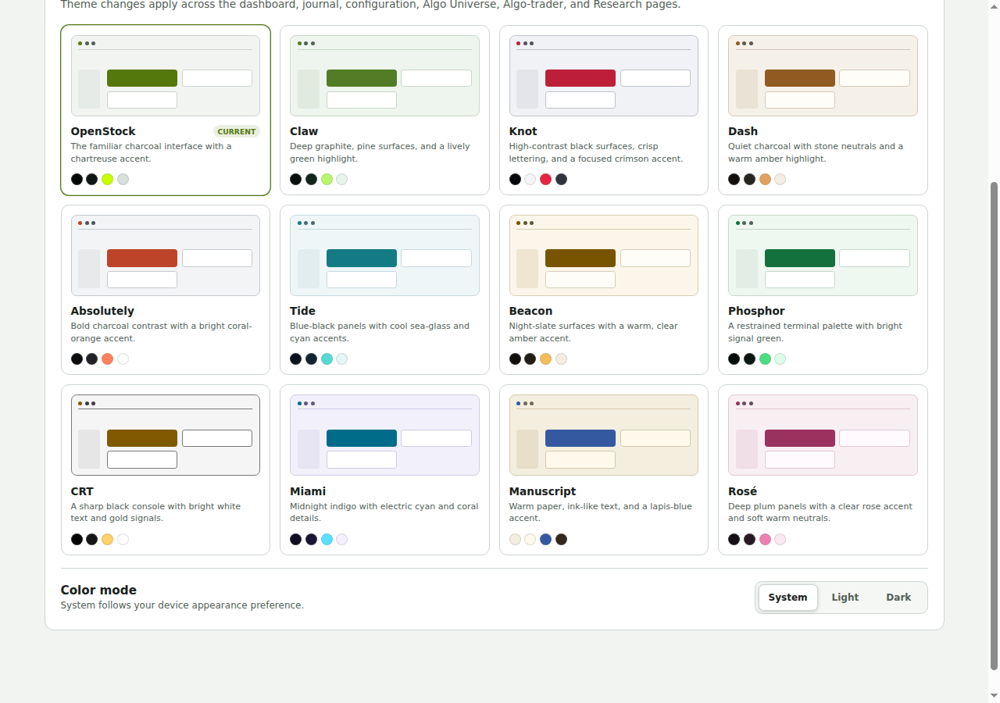
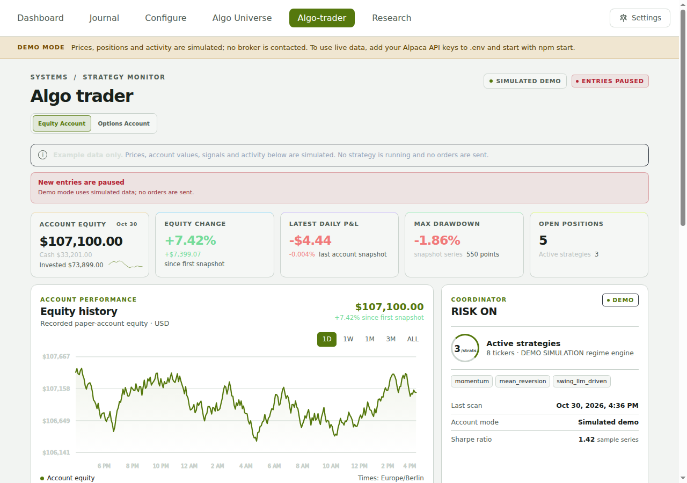
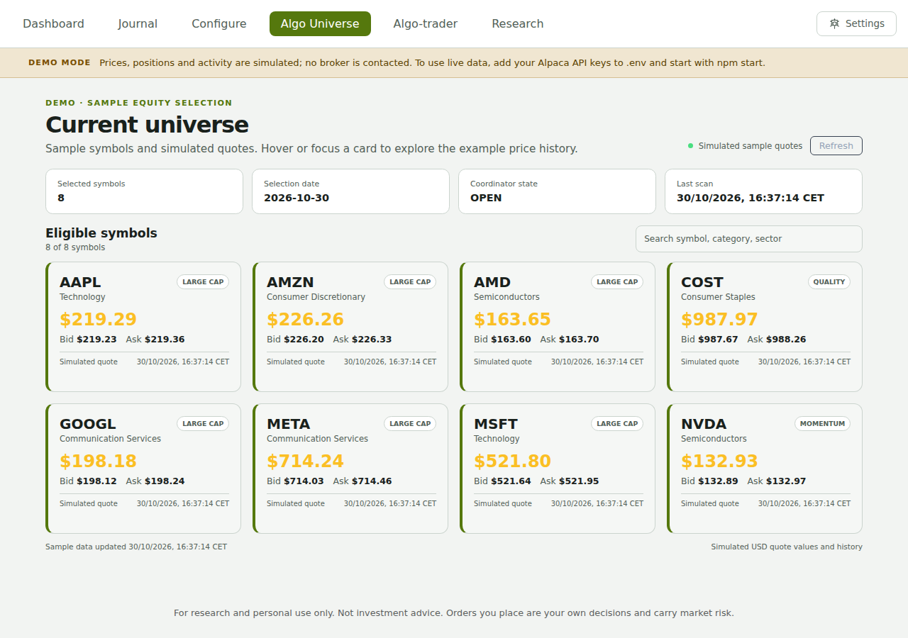
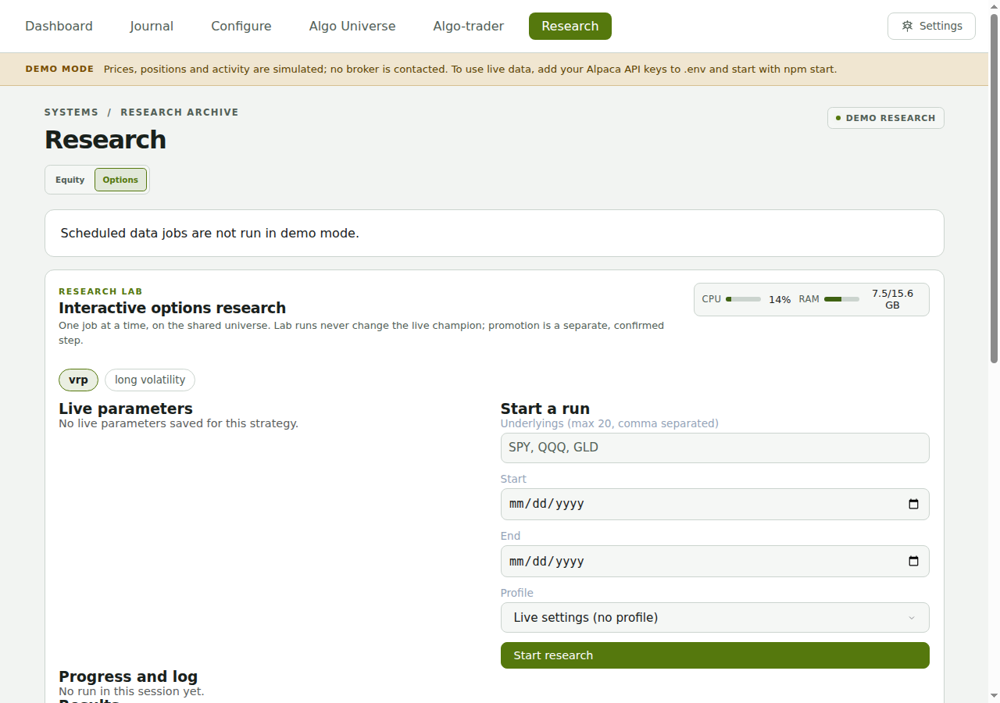

# Features

Part of the [OpenStock README](../README.md). The screenshots come from the demo, which runs with `npm run demo`; see [Demo mode](demo-mode.md). They show simulated data only, so no account figures appear in them.

- **Dashboard:** Alpaca USD quotes for every watched stock, with bid and ask, buy-in and alert levels. Open a stock to see its price history.

  

- **Monitoring and alerts:** a one-shot monitor cycle (`npm run monitor`, or a scheduler) checks BUY and SELL thresholds against Alpaca quotes. Each alert level fires once per episode and is delivered to Telegram from a durable outbox, so a poll never sends twice.

  

- **Trading journal:** Alpaca USD balances, positions, and fills. The equity curve is continuous: the server records the manual account every five minutes, and older days come from Alpaca's daily history.

  

- **Capital events:** initial capital, deposits, withdrawals and financing are tracked separately, so they never count as trading P/L.

- **Analytics:** P/L, return, win rate, drawdown, monthly and per-stock performance, and the trade list. Figures show `N/A` or `Insufficient data` until enough history exists.

  

- **Configure:** the watchlist with alert levels per stock, a real-order switch with a budget for each level, one-time percentage moves, and manual limit orders from an alert. The demo runs the same page on simulated data.

  

- **Themes:** twelve colour themes, each in light, dark or system mode. The choice is saved in the browser.

  

- **Algo Trader:** the equity and options accounts, each with its performance, risk, coordinator state and activity. Strategy settings are editable from the page.

  

  

- **Algo Universe:** the live eligible universe, its quotes and history.

  

- **Research:** interactive options and equity research runs with a live log, results, profiles and rollback, and a status panel for the scheduled data jobs. The panel shows the ThetaData history backfill: its phase, how many symbols have finished each archive, whether `THETA_DATA_API_KEY` is still in `.env`, and the action to take when the backfill is complete. It also lists each scheduled job's log with its last error. The panel reads only status files and never shows a key. It is not shown in the demo, which has no scheduled jobs.

  

- **Scheduled jobs and reports:** the hourly health check, the Alpaca options captures, the ThetaData history pipeline, the LLM-driven silent run, and the morning digest and research reports run from the local crontab, without OpenClaw. The reports are written by a configured LLM (hosted, or a local model) and sent to Telegram. Each job has its own log file, and a daily job keeps the logs small. See [Algo automations](../algo-trader/docs/automations.md).

## Features at a glance

- **Alerts that fire once.** Each level queues one alert in a durable outbox. The outbox retries delivery and never sends twice.
- **A journal that never invents P/L.** Deposits and withdrawals are tracked separately from trading results.
- **Figures that admit missing data.** Metrics show `N/A` or `Insufficient data` until enough history exists.
- **Unattended research data.** The ThetaData history fills in by itself, one archive at a time, and tells you when it's finished and when to cancel the subscription.
